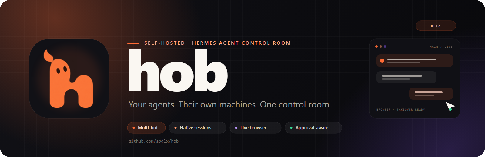

<p align="center">
  
</p>

<h1 align="center">hob</h1>

<p align="center">
  <strong>A self-hosted control room for Hermes Agent.</strong><br />
  Give every bot its own memory, credentials, workspace, and browser — then run them all from one private dashboard.
</p>

<p align="center">
  <a href="https://github.com/abdlx/hob/actions/workflows/coolify-build.yml">
    
  </a>
  <a href="LICENSE">
    
  </a>
  
  
  
  
  
  
</p>

<p align="center">
  <code>hermes-agent</code> · <code>ai-agents</code> · <code>multi-agent</code> · <code>self-hosted</code> ·
  <code>docker</code> · <code>coolify</code> · <code>browser-automation</code> · <code>cdp</code> ·
  <code>react</code> · <code>typescript</code> · <code>nodejs</code> · <code>llm</code> · <code>mcp</code>
</p>

> [!WARNING]
> **hob is a self-hosted beta.** It is not hardened for hostile multi-tenant hosting. Run it behind HTTPS, keep the data volume private, and use separate OS users or containers when bots must not be able to read each other's files.

## Why hob

Hermes Agent is a capable personal agent runtime, but its native surfaces are optimized for one operator and one home directory. hob adds the product layer around it:

- **One dashboard, many bots.** Main plus operator-created bots, each with independent sessions, memory, provider credentials, workspaces, and browser state.
- **A real browser, not a screenshot toy.** Per-bot Chromium processes with persistent logins, multi-tab control, a live viewer, human takeover, and exact-coordinate input.
- **Native Hermes underneath.** Sessions, tools, approvals, questions, memory, skills, and scheduling stay owned by upstream Hermes. hob owns the interface, authentication, routing, and browser gateway.
- **Deployable as one container.** The Docker image combines the dashboard, Node server, and a digest-pinned Hermes runtime. Only the app port is exposed.

Hermes source is vendored only as a reference. The image applies checksum-guarded compatibility extensions to the pinned runtime: native dashboard heartbeat admission, profile-scoped JSON controls for complete proposal reviews and schedule previews, timezone-cache refresh after a bot's timezone changes, and console evaluation on the selected browser page. Hermes retains scheduling, memory/skill application, and execution ownership. Rebuild the application image when upgrading these controls.

In **Settings → Plugins & integrations**, browse app tiles and open a tile for its full details and install controls. In **Settings → Automation**, select a bot's native conversation to start a goal or configure a heartbeat, including pause, resume and clear. Scheduled tasks use Hermes's own scheduler; `0 9 * * *` runs daily at 9 AM in the bot's configured timezone. Background handoff results are delivered to the caller and Main through Hermes's **Bot Chat**, while each exchange keeps its own transcript.

## Contents

- [Android and iPhone app](mobile/README.md)
- [Features](#features)
- [Architecture](#architecture)
- [Quick start](#quick-start)
- [First-run setup](#first-run-setup)
- [Configuration](#configuration)
- [Browser control](#browser-control)
- [Security model](#security-model)
- [Data and upgrades](#data-and-upgrades)
- [Development](#development)
- [Project status](#project-status)
- [Documentation](#documentation)
- [Contributing](#contributing)
- [License](#license)

## Features

| Area | What you get |
| --- | --- |
| **Multi-bot** | A persistent operator roster with a default **Main** bot and explicitly created bots. Each bot has its own Hermes profile, listener credential, workspace, conversations, and settings. |
| **Chat** | Native durable Hermes sessions, streamed replies, tool activity, approvals, clarifying questions, stop/cancel, run recovery, and multi-bot group rooms. |
| **Browser** | One managed Chromium identity per bot, persistent cookies and tabs, live frame streaming, human takeover, tab actions, precision input methods over CDP, and opt-in CAPTCHA challenge handling. |
| **Media** | Inline images in chat bubbles from `MEDIA:`, `@image:`, `#media:` links, and Markdown image syntax. Local files are served through an authenticated, profile-scoped endpoint. |
| **Providers** | Private saved-provider cards, one-click API-key reuse across bots, model catalogs, custom OpenAI-compatible endpoints, device sign-in where supported, and separate model selection. |
| **Tools and MCP** | Native toolset controls, dependency setup, messaging channels, MCP servers, OAuth sign-in, connection probes, and per-bot enable/disable. |
| **Memory and learning** | Built-in or external memory providers, personality/identity editing, task-memory and user-profile switches, and approval-gated skill/memory writes. |
| **Workspace** | Goals and scheduled tasks, workspace files, skill review in Workshop, activity, approvals, and a live browser side panel. |
| **Review and delivery** | Complete, revision-bound memory/skill proposals, explicit approve/reject decisions and decision history; supported result files copied into workspace `artifacts/`, with scoped downloads up to 25 MB. |
| **Input and preferences** | Consent-based voice transcription into an editable draft, per-bot reply/title language, timezone, native turn/time limits, and conversation title correction. |
| **Operations** | Login rate limiting, SameSite cookies, origin checks, loopback-only Hermes APIs, health/readiness endpoints, build provenance, graceful browser shutdown, and persisted state. |

## Architecture

```text
┌──────────────────────────────────────────────┐
│              Browser / hob dashboard         │
│         React · TypeScript · Tailwind        │
└──────────────────────┬───────────────────────┘
                       │ HTTPS · SSE · WebSocket
┌──────────────────────▼───────────────────────┐
│                hob server (Node 24)          │
│  auth · chat adapter · media · browser gateway│
└───────────┬───────────────────────┬──────────┘
            │ private loopback      │ CDP over pipe
┌───────────▼──────────┐   ┌────────▼──────────┐
│ Hermes settings :8080│   │ per-bot Chromium  │
│ Hermes runtime :8642 │   │ persistent profile│
└───────────┬──────────┘   └───────────────────┘
            │
┌───────────▼──────────────────────────────────┐
│      Hermes Agent (qualified extensions)    │
│  profiles · tools · memory · skills · models │
└──────────────────────────────────────────────┘
```

Only port **3000** serves the application. Hermes' settings and runtime APIs bind to loopback and are never published by the supplied Compose files. Model and tool credentials are entered in Settings and remain server-side.

The runtime image is pinned by digest and built from a pinned upstream Hermes commit that includes the native session authority hob requires. The published Hermes `0.22.2` image does not provide that contract. Runtime upgrades are deliberate, tested changes — not automatic in-container updates.

## Quick start

### Requirements

- Linux **amd64** for the supplied container image.
- Docker Engine with Compose v2.
- Node.js **24.16+** only if you are developing locally.

### Docker Compose

```sh
git clone https://github.com/abdlx/hob.git
cd hob
cp .env.example .env
```

Edit `.env` and set a strong password and an independent session secret:

```dotenv
HOB_PASSWORD=replace-with-a-long-random-password
HOB_SESSION_SECRET=replace-with-at-least-32-random-bytes
```

Build and start the standalone stack:

```sh
docker compose -f compose.yaml -f compose.standalone.yaml build
docker compose -f compose.yaml -f compose.standalone.yaml up -d
docker compose -f compose.yaml -f compose.standalone.yaml logs --tail=100 hob
```

The standalone overlay binds to `127.0.0.1:3000`. Open <http://localhost:3000>.

For a remote VPS, tunnel the port instead of exposing it:

```sh
ssh -L 3000:127.0.0.1:3000 user@your-vps
```

For public access, put an HTTPS reverse proxy in front of port 3000 and set:

```dotenv
HOB_PUBLIC_URL=https://hob.example.com
HOB_SECURE_COOKIES=true
```

### Coolify

Create a **Docker Compose** application from this repository using `compose.yaml`, enable **Preserve Repository During Deployment**, and assign a domain to the `hob` service on port **3000**. Coolify generates the app password and session secret automatically.

See [Coolify deployment](deploy/COOLIFY.md) for the exact settings, environment variables, and commit verification steps.

### Health and version

- `GET /healthz` — settings service and container health.
- `GET /api/readiness` — authenticated runtime readiness.
- `GET /api/version` — commit, branch, and build timestamp baked into the image.

A healthy settings service does not prove that a provider or tool is configured. Complete the first-run steps and run a real turn.

## First-run setup

1. **Sign in** with `HOB_PASSWORD` (or the password Coolify generated).
2. Open **Settings → Main**.
3. Choose a provider from the native catalog and save its API key under the suggested credential name. Supported providers may also offer device sign-in.
4. Choose or enter a model and select it. For a custom endpoint, choose **Custom compatible endpoint**, enter its URL, a distinct endpoint name, and a key if required.
5. Start a new conversation and verify a reply **and** a tool task.
6. Create additional bots deliberately in Settings. Each bot needs its own provider/model and workspace setup. Incomplete setup stays visible for explicit recovery and never activates silently.
7. Optional: configure **Tools & providers**, **Messaging channels**, **MCP servers**, **Memory providers**, and **Learning & write approvals** for each bot.

To switch a bot's model, open its right sidebar and click its current model name or the **Settings** tab. Choose a provider and model, then **Save model**. Start a new conversation to use the saved selection. Connect new provider credentials and define custom endpoints in the main Settings page.

**Saved providers** in Models & providers discovers API keys already saved in your bots' native Hermes profiles. Select a bot and click **Connect** to reuse a saved provider key; its model selection stays unchanged. An existing target key is preserved. Keys never appear in the cards or their API responses. Each bot holds its own copy, so replacing one key does not rotate other bots' keys. OAuth accounts and custom endpoint definitions retain their separate setup flows.

**Verify key** asks Hermes to check the saved credential with its provider. “Verified recently” requires provider acceptance, expires after ten minutes or a profile credential-file change, and resets on application restart. Unsupported or unavailable probes remain unverified; saving a key alone does not prove it works.

Saving a channel's fields does not connect it. Connecting is a separate confirmed action. The same is true for several destructive or credential-bearing operations: hob asks for confirmation and does not retry ambiguous writes.

## Configuration

### Application environment

| Variable | Required | Purpose |
| --- | --- | --- |
| `HOB_PASSWORD` | Yes | Dashboard login password. Keep it private. |
| `HOB_SESSION_SECRET` | Yes | Independent secret used to sign session cookies. Use at least 32 random bytes. |
| `HOB_PUBLIC_URL` | Recommended | Exact browser origin, e.g. `https://hob.example.com`. Required for hosted MCP OAuth callbacks and secure origin checks. |
| `HOB_SECURE_COOKIES` | For HTTPS | Set to `true` when the browser reaches hob over HTTPS. |
| `HOB_BIND_ADDRESS` | Standalone | Host interface for the standalone overlay. Defaults to `127.0.0.1`. |
| `HOB_PORT` | Optional | Host port for the standalone overlay. Defaults to `3000`. |

Coolify supplies `SERVICE_PASSWORD_64_HOB` and `SERVICE_REALBASE64_64_HOB` through `compose.yaml`. Keep those values stable across redeploys.

**Do not put model or tool credentials in Compose.** Enter them in Settings so they stay out of the repository and deployment configuration.

### Internal paths

The container keeps application state under `/opt/data`:

```text
/opt/data/
├── .hob/                    # hob state: roster, run journal, listener credentials
├── workspaces/
│   ├── main/                # Main bot workspace
│   └── bots/<name>/         # named bot workspaces
├── profiles/                # Hermes profile homes
└── ...                      # Hermes config, logs, cache, and native state
```

The managed browser profiles live under `HOB_STATE_DIR/browsers/<bot>/<profile-id>/chromium`.

## Browser control

Each bot gets its own Chromium process, CDP gateway credential, and persistent user-data directory. Bots do not share logins, cookies, tabs, or browser state.

Agents can create, list, activate, and close tabs through native `browser_cdp` calls:

- `Target.createTarget` with a `url`
- `Target.getTargets`
- `Target.activateTarget` with a `targetId`
- `Target.closeTarget` with a `targetId`

For page commands, pass the chosen tab as `target_id`. Explicit activation updates the live viewer unless the person has pinned another tab.

### Immediate input, visible cursor

Agent input is forwarded to Chromium immediately and unchanged. hob does not synthesize a trajectory or insert hover/press delays. The dashboard cursor animates toward reported coordinates on its own, so the viewer sees a smooth pointer while the page receives the exact event without extra latency. Click indicators are visual only.

### Precision methods

For coordinate work that must not miss, the gateway exposes exact input methods through `browser_cdp`. Coordinates are viewport CSS pixels.

| Method | Parameters |
| --- | --- |
| `Hob.input.move` | `x`, `y`, optional `modifiers` |
| `Hob.input.click` | `x`, `y`, `button`, `clickCount`, `delayMs`, `verify` (default `true`), `expected` |
| `Hob.input.drag` | `from`, `to`, `button`, `steps`, optional start-point `expected` |
| `Hob.input.type` | `text`, optional `x`/`y` to click first, `replace` |
| `Hob.input.key` | `key` (`Enter`, `Tab`, `Control+a`, `Shift+ArrowDown`, ...) |
| `Hob.input.scroll` | `x`, `y`, `deltaY`, optional `deltaX` |
| `Hob.input.hitTest` | `x`, `y`, optional `expected` |
| `Hob.input.help` | No page target required; returns the full parameter list |

`expected` is either a case-insensitive string matched against the hit element's tag, id, class, role, or own text, or an object such as:

```json
{ "tag": "button", "text": "Sign in" }
```

A verified click hit-tests the point first and refuses to press when the element does not match. A mismatch returns an error and the click does not happen.

```json
{"method":"Hob.input.click","params":{"x":760,"y":540,"expected":{"tag":"button","text":"Sign in"}}}
{"method":"Hob.input.drag","params":{"from":{"x":100,"y":300},"to":{"x":400,"y":300},"steps":12}}
{"method":"Hob.input.scroll","params":{"x":640,"y":512,"deltaY":600}}
```

These actions obey the same human-control lease as raw CDP. While a person holds control, an agent request waits and is then refused rather than mutating the page. Precision actions act on a page, so pass the tab as `target_id`; `Hob.input.help` works without one.

### Human takeover

The live viewer can take control, send real input, and hand control back. Agent mutations queue during human control and resume on handback. A dropped viewer does not silently steal or release control. The same lease protects raw CDP and the dashboard's tab actions.

### CAPTCHA handling

hob treats a confirmed CAPTCHA as session state, not a tool error. In `human` mode (the default), it parks agent mutations, shows the interruption in the browser viewer, and requests human intervention without running automated solvers or paid services. Take control, resolve the challenge, then hand control back. Waiting mutations resume after observed resolution, or fail with a structured `challenge_timeout` when the bounded wait expires. `HOB_CAPTCHA=detect` observes without parking. The existing `solve` mode remains an explicit legacy opt-in.

Image-grid solving requires `HOB_CAPTCHA_VISION_URL` (an OpenAI-compatible chat endpoint), `HOB_CAPTCHA_VISION_MODEL`, and optionally `HOB_CAPTCHA_VISION_KEY`. CapSolver requires `HOB_CAPTCHA_KEY_CAPSOLVER`; `HOB_CAPTCHA_SERVICE_DAILY_CAP` defaults to 50 attempts per day. Whole-page block interstitials are refused immediately and the host is cooled down because there is no puzzle to solve.

This is best-effort. Score-based systems may never present a puzzle, solver tokens do not create session reputation, and providers change their markup. See [CAPTCHA.md](CAPTCHA.md) for modes, telemetry, and limits. Browser automation can still be detected. Chromium starts with `--disable-blink-features=AutomationControlled`, which suppresses the native `navigator.webdriver` marker without injecting a JavaScript getter; that is a compatibility setting, not a promise of human classification.

## Security model

hob is designed for a trusted operator, not for mutually hostile tenants.

- **Single public port.** Only the app port (`3000`) is exposed. Hermes settings (`8080`) and runtime (`8642`) stay on loopback.
- **Server-side secrets.** Provider keys, listener credentials, and the Hermes dashboard token never reach the browser.
- **Authenticated API.** `/api/*` is gated by an HttpOnly, SameSite=Strict session cookie. Browser logins last 30 days and renew on authenticated API use during the final week. Existing valid one-day cookies upgrade on their next API request. Changing the password or session secret invalidates browser logins. Mobile WebView cookies cannot outlive their 30-day device enrollment and are invalidated when that device is revoked. Login attempts are rate-limited, and state-changing requests check their origin.
- **Profile-bound routing.** Every dashboard operation selects one enrolled bot. Native credentials and session keys are scoped to that bot.
- **Scoped local media.** The inline-media endpoint serves only raster images from the selected bot's profile home, workspace, or HOB browser captures. Path traversal, symlink escapes, other profiles, and the default profile's shared `profiles/`/`workspaces/bots/` subtrees are refused.
- **No Docker socket.** The supplied Compose stack does not mount the host Docker socket. Compose drops every capability except the six required by the upstream volume initializer (`CHOWN`, `DAC_OVERRIDE`, `FOWNER`, `SETGID`, `SETUID`, `KILL`) and retains `no-new-privileges`. Application processes run as the unprivileged Hermes user.
- **Bot process isolation.** The default Compose configuration uses a shared OS user. Add [`compose.isolation.yaml`](compose.isolation.yaml) to run each bot's terminal/file/code operations and managed Chromium under a distinct Linux UID, with separate persistent workspace/browser data. See [setup and boundaries](deploy/README.md#per-bot-linux-process-isolation). Native gateway, plugin and MCP code remain trusted operator infrastructure.
- **Local MCP executables.** Local-executable MCP servers run on the Hermes host. Profile separation is not an execution sandbox there either.
- **No encryption at rest.** The data volume contains credentials and conversation state. Protect the volume, restrict access, and keep backups private.

For a public deployment, terminate TLS at a reverse proxy, set `HOB_PUBLIC_URL` and `HOB_SECURE_COOKIES=true`, and do not publish the Hermes ports.

## Data and upgrades

The `hermes-data` volume mounts at `/opt/data`. Back up the **entire volume while the stack is stopped**, including SQLite companion files and `.hob/`. Test a restore before relying on it.

Upgrades are deliberate:

1. Pin a new Hermes runtime digest.
2. Build a candidate image.
3. Test against a copy of your state: login, chat, tools, profiles, groups, browser tabs, and recovery.
4. Promote only after the candidate passes.

Do not run an in-container source updater. An older runtime may not read state written by a newer one, so keep a matching backup for rollback.

The older OpenClaw `muse-data` volume is preserved by Docker but is **not** mounted or automatically migrated. Keep it if it contains history you still need. This historical volume name remains only in upgrade documentation.

The canonical application namespace is now `hob` / `HOB_*`, including the Compose service and browser preferences. Existing `MUSE_*` runtime settings are accepted at the configuration boundary when their `HOB_*` equivalent is unset. On a local source launch, a single real `.muse-data` directory is renamed to `.hob-data`; if both exist, startup stops and requires an explicit `HERMES_HOME`. Explicit homes and the container's `hermes-data` volume remain in place. Browser preferences migrate once, preserving an existing canonical value. The renamed `hob_session` cookie requires signing in again.

For an existing Coolify resource, copy its current password and session-secret values into `SERVICE_PASSWORD_64_HOB` and `SERVICE_REALBASE64_64_HOB` before redeploying, and assign its domain to service `hob`. Keep the same Compose project and `hermes-data` volume. See [the upgrade steps](deploy/COOLIFY.md#upgrade-to-the-hob-namespace).

Back up the complete Hermes home, workspace root (including `artifacts/`), and private HOB state together while work is stopped. In OS-user isolation mode the workspace root is outside the Hermes home. A workspace-only backup omits the delivery receipts and native session/review state. Restore ownership and the same configured paths before starting the pinned image. Result publication preserves source files, never imports another bot's files, and reports a failed delivery rather than treating a scratch link as durable. Files outside the bot's assigned roots must first be copied by that bot into its workspace.

Voice recording requires HTTPS (or localhost) and browser microphone support. Starting a recording and uploading it for transcription are separate actions. Transcription uses the selected bot's configured speech provider; it never sends the resulting message automatically. Mobile WebView permissions and actual speech quality still require device/provider testing. Native turn/time limits are available under Settings → General; they do not implement a currency spending cap across delegated or background work.

The [audit plan](docs/audit-remediation-plan.md) covers all 22 findings without engineering-day estimates. The [session status](docs/audit-session-status.md) separates implemented changes, local regression evidence, and remaining deployment/device acceptance checks.

## Development

The server uses Node's built-in HTTP and test APIs. The frontend uses npm and Vite.

```sh
# server
node --test server/test/*.test.mjs

# frontend contract tests
node --test web/tests/*.test.mjs

# frontend lint and production build
cd web
npm ci
npm run lint
npm run build
```

For local runtime work, use an isolated Hermes home and a supported Hermes Python environment:

```sh
export HERMES_HOME=/path/to/isolated/hermes-home
export HOB_PASSWORD=local-password
export HOB_SESSION_SECRET=local-session-secret
node deploy/start.mjs
```

The supervisor uses `hermes` from `PATH`, or `HERMES_EXECUTABLE` when explicitly supplied. See [deployment details](deploy/README.md) for runtime contracts, test evidence, and known gaps.

### Repository layout

```text
server/              Node application, Hermes adapter, browser gateway, tests
web/                 React dashboard, Vite build, frontend tests
deploy/              supervisor, health checks, Coolify docs, seccomp profile
docs/assets/         README banner and brand assets
hermes-agent/        optional local upstream reference; never patched by hob
compose.yaml         Coolify/production Compose service
compose.standalone.yaml  loopback-only local overlay
Dockerfile           dashboard + pinned Hermes runtime image
```

## Project status

hob is usable for a self-hosted operator who understands the boundaries, but it is **not production-proven**.

Known limits:

- The supplied runtime image targets **Linux amd64**.
- The container smoke workflow uses a deterministic model fixture. Real provider accounts, vendor interoperability, and production-host behavior still need operator verification.
- Native session, approval, question, cancellation, and recovery paths are covered by adapter tests; full end-to-end browser interaction against every vendor remains an ongoing verification area.
- Bots share the container's OS user by default. This is a routing and credential boundary, not a security sandbox.
- Browser automation may be blocked or challenged. CAPTCHA handling defaults to human intervention with a bounded wait and does not guarantee access.
- The pinned runtime is built from an upstream Hermes commit because the published `0.22.2` image lacks the required native session authority. Replacing the pin requires the same native-session checks.
- Older API-era conversations remain available as read-only history; native conversations are the primary path.

When a backend is unavailable, hob surfaces the failure instead of presenting a fabricated model reply or a false deployment success.

## Documentation

- [Deployment and operations](deploy/README.md)
- [Coolify deployment](deploy/COOLIFY.md)
- [CAPTCHA system](CAPTCHA.md)
- [End-to-end test notes](server/e2e/README.md)
- [Frontend notes](web/README.md)
- [Brand and logo notes](web/public/brand/README.md)

## Contributing

Issues and pull requests are welcome. Useful contributions include:

- reproductions with the exact failing path and observed behavior;
- adapter and browser-gateway tests;
- deployment hardening and recovery coverage;
- accessibility and responsive UI improvements;
- documentation fixes that keep the security boundaries accurate.

Please keep changes consistent with the existing architecture:

- do not edit a local `hermes-agent/` reference checkout;
- keep credentials and native tokens server-side;
- bind every operation to one enrolled bot;
- add tests for new adapter, auth, profile, or browser behavior;
- run both the server and frontend suites before opening a PR.

For security-sensitive findings, use GitHub's private security advisory flow rather than a public issue.

## License

MIT © 2026 Mirza Abdullah Baig. See [LICENSE](LICENSE).

Built on the shoulders of [Hermes Agent](https://github.com/NousResearch/hermes-agent). Hermes remains under its own license and is not modified by this repository.
